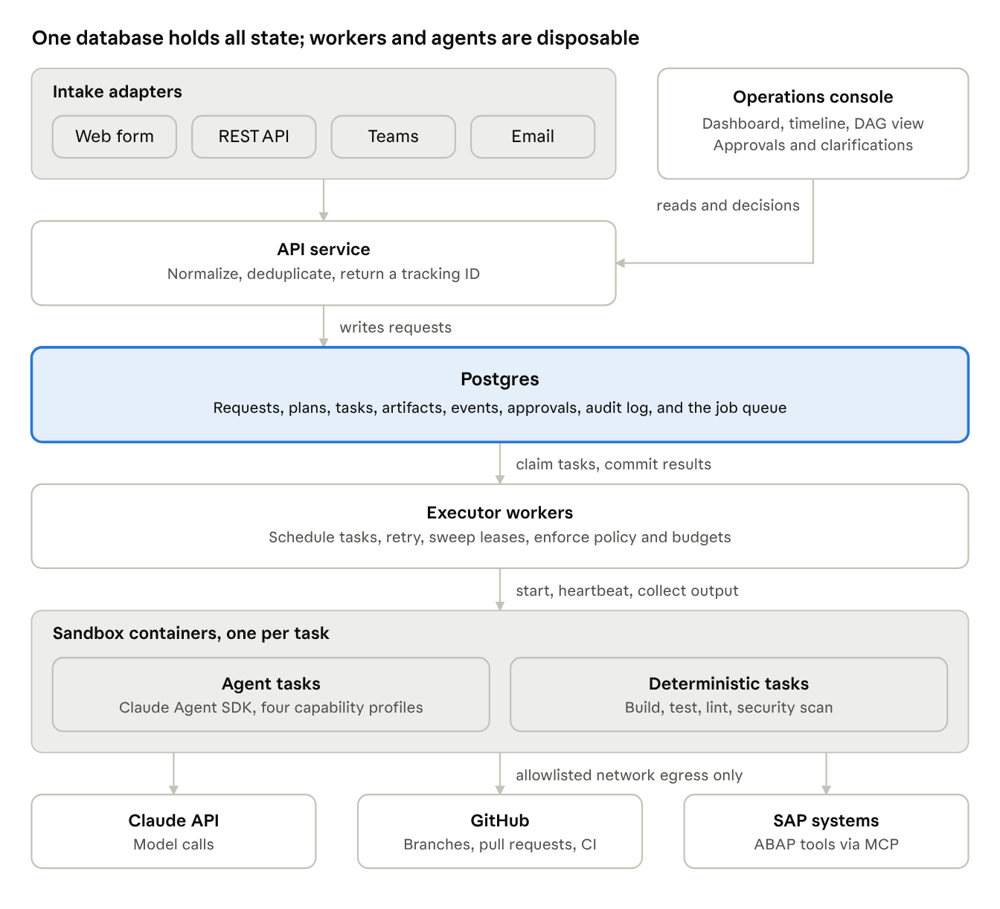
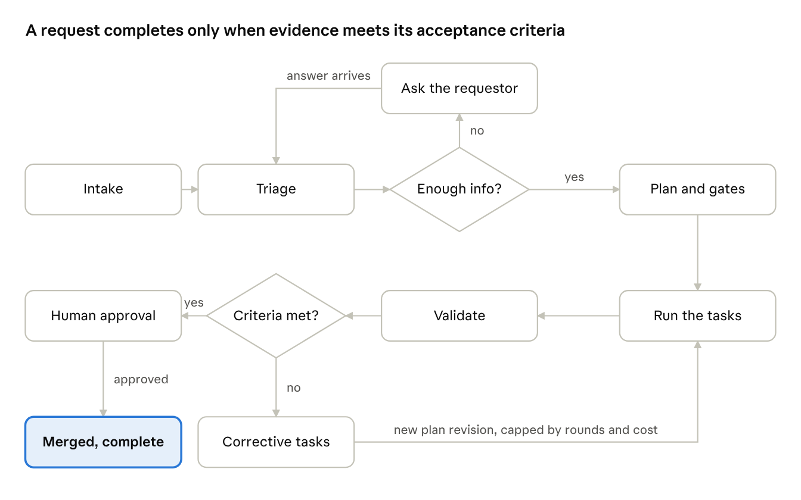
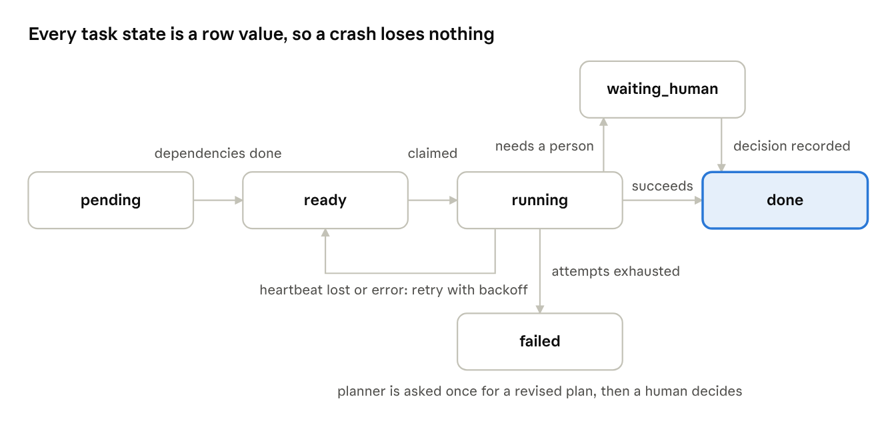

# Software Factory: Revised Architecture

Nov 17, 2026

The factory runs on one Postgres database and a small task executor written in TypeScript, with no third-party workflow engine. LLMs make judgments at four points (triage, planning, implementation, review); code does everything else, including supervision.

## At a glance

Every component above and below Postgres is stateless: the API, the executor workers and the sandbox containers can all be killed and restarted without losing a request.

## What changed from the original spec

Seven decisions changed; the lifecycle (intake, triage, plan, execute, validate, correct, approve, complete) did not.

| Decision | Original spec | Revised |
| --- | --- | --- |
| Workflow engine | Custom durable-execution engine in Rust | A task table in Postgres plus a small executor in TypeScript, using an open-source Postgres job queue (Graphile Worker) |
| Third-party software | Not stated | None paid for; everything is open source and runs on Postgres |
| Supervisor | An LLM agent that tracks and manages the workflow | Deterministic code in the executor; an LLM is called only to replan after a failure |
| Agent roster | 17 role agents (Frontend, Backend, Database and so on) | 4 capability profiles: triage and planning, implementer, reviewer, verifier |
| Planning | Free-form DAG generated per request | Planner composes from vetted templates; approval gates are injected by policy, not chosen by the planner |
| State and projections | Workflow state kept separate from the application database, synchronized by events | One database; task state, events and console read models are written in the same transaction |
| Scope | Multi-tenancy, SSO, DR and horizontal scaling from the start | Internal tool: tenant ID columns and an audit log from day one, the rest deferred |

## Request lifecycle

Two loops keep a request moving without a person: triage asks the requestor when information is missing, and a failed validation adds corrective tasks as a new plan revision. When the round or cost cap is reached, the request stops and waits for a human instead of looping.

## Task engine

The engine is a table of tasks and a worker loop, because a plan is data (a DAG of task rows) rather than code that must be replayed.

- **Plan as rows:** each plan node is one row in `task`, with its dependencies in `task_dependency`. A task becomes `ready` when every task it depends on is `done`.
- **Claiming work:** workers take `ready` tasks from the job queue (Graphile Worker, chosen because jobs are enqueued inside the same transaction as the task update), which locks rows with `SKIP LOCKED` so two workers never run the same task.
- **Heartbeats and leases:** a running task updates `heartbeat_at` every 30 seconds. A sweep returns any task whose heartbeat is older than its lease to `ready` and increments its attempt count.
- **Completion in one transaction:** marking the task `done`, storing its output, appending the event and marking newly unblocked tasks `ready` commit together or not at all.
- **Human gates:** an approval is a task in `waiting_human`. It holds no worker and costs nothing until an API call records the decision.
- **LLM outputs stored once:** a finished task's output is read from its row. Recovery never calls the model again for work already recorded.
- **Plan revisions:** corrective work is added as a new `plan_revision` that appends tasks. Existing rows are never rewritten.
- **Budgets:** each request has a cost cap and a limit on validate-and-correct rounds. Reaching either moves the request to `waiting_human`.

Execution is at-least-once: a task can run twice after a crash. Every step with an outside effect (opening a PR, posting a comment) carries an idempotency key derived from the task ID.

## Agents

Four capability profiles replace the 17 role agents. A profile is a registry row (prompt version, model, tools, permissions, limits), so adding one is configuration, not code.

| Profile | Job | Tools and access | Output |
| --- | --- | --- | --- |
| Triage and planner | Classify the request, ask for missing information, pick and parameterize a plan template | Read-only repository access; no code execution | Triage result and plan, both as typed JSON |
| Implementer | Make the change on a branch | Read and write in one repository checkout inside a sandbox container; shell; ABAP development tools via MCP where the target is SAP | Branch, pull request, change summary |
| Reviewer | Review the diff against the request and repository conventions | Read-only on the pull request | Findings, each with a severity |
| Verifier | Map each acceptance criterion to evidence | Read-only on CI results, test reports and the pull request | Validation report: pass or fail per criterion |

Agents run on the Claude Agent SDK, one ephemeral container per task. They exchange typed artifacts stored in the database, never each other's conversation history.

Build, test, lint and security scans are plain task types that run commands and record results. They are not agents.

## Data model

Ten tables hold everything; the console reads the same rows the executor writes.

| Table | Holds | Key columns |
| --- | --- | --- |
| `work_request` | One row per intake request | id, tenant_id, source, requestor, title, description, repository, priority, acceptance_criteria, status, dedupe_key |
| `plan_revision` | Each version of a request's plan | id, request_id, revision_no, template, created_by, reason |
| `task` | One row per plan node; the engine's state | id, request_id, plan_revision_id, type, profile, status, attempt, max_attempts, heartbeat_at, lease_until, input, output, idempotency_key |
| `task_dependency` | Edges of the DAG | task_id, depends_on_task_id |
| `agent_run` | Each attempt by an agent | id, task_id, profile, model, prompt_version, tokens_in, tokens_out, cost, duration, status, error |
| `artifact` | Typed outputs passed between tasks | id, task_id, type, schema_version, content or location |
| `approval` | Human decisions | id, task_id, kind, requested_from, decision, decided_by, decided_at, comment |
| `event` | Append-only history; drives the timeline and live updates | id, request_id, task_id, type, payload, created_at |
| `agent_profile` | The agent registry | name, prompt_version, model, tools, permissions, limits |
| `audit_log` | Who did what, including humans | id, actor, action, target, created_at |

`work_request.status` is derived from its tasks in the same transaction that changes them, so the two cannot disagree.

## Boundaries

Agents make judgments, application code makes every state change, and the database is the only place state lives.

| Layer | Owns | Never does |
| --- | --- | --- |
| AI agents | Understanding the request, choosing a template, writing code, reviewing, weighing evidence against criteria | Change task or request status, decide whether an approval gate applies, retry themselves, hold credentials beyond one task |
| Application services (API, executor, policy) | Intake normalization and deduplication, plan validation, gate injection by risk class, scheduling, retries, timeouts, budgets, cost accounting, notifications | Judge whether code is correct or a requirement is met |
| Database | Requests, plans, task state, artifacts, events, approvals, audit log; the job queue itself | Business logic in triggers or stored procedures |
| Message and event infrastructure | None as a separate system: the `event` table plus Postgres `LISTEN/NOTIFY` feed the console's live updates | Carry state that is not also in a table |

## Failure handling

Every failure resolves to one of three outcomes: retry the task, add a corrective task, or stop and ask a human.

| Failure | Detection | Response |
| --- | --- | --- |
| Worker or agent container crashes | Heartbeat older than the lease | Task returns to `ready`; attempt count goes up |
| LLM API error or rate limit | Error from the call | Retry with backoff inside the task; after the limit, the task fails |
| Agent returns invalid output | Schema validation of the artifact | One repair attempt with the validation error, then a normal retry |
| Build or tests fail | CI result | Corrective implementer task with the failure log as input |
| Git conflict | Push or rebase fails | Rebase task; if it conflicts again, escalate to a human |
| Task exceeds its time limit | Sweep on `lease_until` | Kill the container, retry once, then fail |
| Dependency unavailable (GitHub, SAP system) | Error from the tool | Retry with longer backoff; the request shows as blocked in the console |
| Retries exhausted | Attempt count reaches the maximum | Task `failed`; planner is asked once for a revised plan, otherwise escalate |
| Approval not answered for days | Nothing to detect; the task waits | Reminder after a set interval; no timeout by default |
| Duplicate intake | `dedupe_key` (source plus message ID, or a content hash) | Return the existing tracking ID |
| Correction loop does not converge | Round or cost cap reached | Request moves to `waiting_human` with the validation report |

## Security

The design assumes any agent can be misled by its input, so limits are enforced outside the agent.

- **Sandbox per task:** each agent task runs in a fresh container holding one repository checkout. The container is destroyed when the task ends.
- **Short-lived credentials:** the executor mints a GitHub App token scoped to one repository for one task. Agents never see long-lived secrets.
- **Network egress:** containers reach an allowlist only (the model API, GitHub, package registries, named SAP systems).
- **Untrusted intake:** request text from email, Teams or the form is data. It is passed to agents as quoted content, and the triage profile has no write access, so an instruction hidden in a request cannot act on its own.
- **Branch protection:** agents push to branches and open pull requests. Merging to a protected branch always needs a human approval recorded in `approval`.
- **Gates by policy:** risk class (set by rules on repository, paths touched and request type) decides which approvals a plan must contain. The plan validator rejects a plan that lacks them.
- **Audit:** every status change, approval and credential issue is written to `audit_log`.

## MVP and phases

The first phase ends when a request typed into the web form becomes a merged pull request with no engineer touching the code.

| Phase | Scope | Done when |
| --- | --- | --- |
| 1. One path end to end | Web form and REST intake; one GitHub repository; request classes minor task and bug fix; two plan templates; all four profiles; human approves the merge; console with request list, timeline and cost | A request produces a merged pull request, and killing a worker mid-task loses nothing |
| 2. Dynamic plans | Template library for enhancement, refactoring, documentation and test automation; parallel tasks; plan revisions and the correction loop with caps; DAG view in the console | A failed validation produces corrective tasks and converges or escalates on its own |
| 3. Enterprise intake and SAP | Teams and email adapters; SAP profile using ABAP development tools; risk classes and policy gates; SSO and role-based access | A Teams message becomes a tracked request with the right approvals attached |
| 4. Scale-out | Multiple repositories per request; deployment tasks; dashboards for failure rate and cost; an evaluation set of past requests replayed against prompt changes | A prompt or model change is measured before it ships |

Two numbers to track from phase 1: the share of pull requests merged without human edits, and cost per request.

## MVP decisions

The pilot runs on this project's own repository with one approver; only the SAP question stays open, and it is not needed until phase 3.

| Question | Decision |
| --- | --- |
| Pilot repository and team | This project's own repository ([droidment/Clever_SF_Factory](https://github.com/droidment/Clever_SF_Factory)): the factory builds itself. It needs CI and a test suite before the first agent task, because the verifier relies on CI results as evidence |
| Where sandbox containers run | Docker on a single Linux VM, the same one that runs the executor; one container per task |
| Who approves merges | One approver, the repository owner, through a normal GitHub pull request review. Branch protection requires one approval |
| Per-request cost cap | $10 per request and 3 correction rounds to start; adjust after the first 20 to 30 requests |
| Job queue | Graphile Worker |

Deferred to phase 3: whether SAP work goes through pull requests (abapGit) or transports, and who releases transports.
