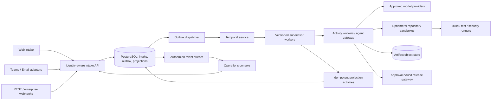
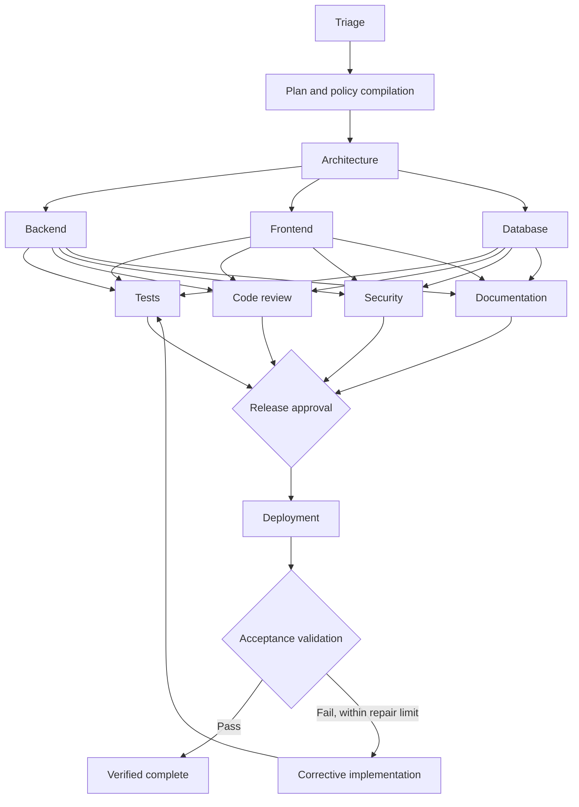

# Software Factory: architecture and delivery design

> **Update, 2026-11-18.** Temporal has been removed. Durable execution now runs on PostgreSQL alone; see [the Postgres runtime](postgres-runtime.md), which supersedes what this document says about Temporal, workflows, activities, signals, the dispatcher and Temporal Cloud. Those passages are kept as the record of the original design and have not been rewritten yet. `FACTORY_MODE=temporal` is now `FACTORY_MODE=gateway` with `FACTORY_RUNTIME=postgres`.

Status: executable reference implementation, with an explicit production-readiness backlog. This repository is not a claim of enterprise certification or a connected autonomous coding service. The local demo uses simulated agents; Temporal mode requires a real execution gateway. No account credentials, repository permissions, Teams subscriptions, email subscriptions, or production environments were provided.

Anthropic draft mode now provides a direct model integration for local triage, planning and unexecuted artifacts. Its terminal status is `drafted`; generated content cannot establish verified completion. It does not add repository access or execution tools to the production gateway. See [Anthropic setup](anthropic.md).

## 1. Recommendation and architectural boundaries

Use **Temporal as the durable control plane**. The difficult part of this system is retaining correct business progress across machine failures, external calls, parallel tasks, and decisions that arrive days later. Keep AI decisions outside workflow code and record their validated results as activity outputs. Temporal rebuilds workflow state from recorded history; it does not need the model to make the same decision twice. See [Temporal's deterministic execution model](https://github.com/temporalio/sdk-python/blob/main/README.md).



| Component | Owns | Must not own |
|---|---|---|
| Temporal workflow | DAG readiness, bounded concurrency, retries via activity policy, human wait state, correction limits, cancellation boundaries, terminal decision | HTTP, SQL, filesystem access, random model sampling, arbitrary generated code |
| Temporal activity | Agent invocation, schema/policy validation, side effects, artifact persistence, event projection | Independent competing business workflow scheduler |
| AI agent | Triage, scope analysis, proposed task graph, implementation decisions, review findings, evidence-based validation | Authorizing its own permissions, bypassing policy, declaring completion without criteria |
| Application services | Authentication, authorization, normalization, intake dedupe, transactional commands, read API, live updates | Treating database status as the source of workflow scheduling decisions |
| Application database | Tenant-scoped requests, accepted commands, decisions, append-only events, query projections, execution receipts | Replacing Temporal's workflow history |
| Event infrastructure | At-least-once command delivery and idempotent read projections; later Kafka/Service Bus fan-out | Exactly-once claims across arbitrary tools |
| Tool / model gateway | Credential custody, repository policy, model routing, sandboxes, hard cost limits, tool receipts | Trusting requested tools or permissions from prompt text |

## 2. Temporal versus alternatives

| Choice | Strength | Tradeoff for this factory |
|---|---|---|
| Temporal | Code-based durable state, long waits, activity retry/timeout semantics, signals, parallel orchestration, replay tooling | Requires workflow determinism, worker lifecycle discipline, persistence operations or managed service |
| Azure Durable Functions | Durable orchestrators, activity functions and human interaction; natural fit with Azure Functions operations | Good Azure-first alternative; different host, scaling, and programming constraints. Evaluate if Azure platform standardization outweighs portability. [Microsoft overview](https://learn.microsoft.com/en-us/azure/durable-task/durable-functions/durable-functions-overview) |
| AWS Step Functions Standard | Managed state machines and AWS integration | Strong AWS-only alternative; Standard execution duration and history constraints affect multi-year initiatives. Express has different duration and execution semantics. [AWS workflow types](https://docs.aws.amazon.com/step-functions/latest/dg/choosing-workflow-type.html) |
| LangGraph | Agent graph state and checkpoint persistence | Useful **inside** an agent activity or agent service; does not remove the need to define enterprise approval, cross-service side-effect, and delivery guarantees. [LangGraph persistence](https://docs.langchain.com/oss/python/langgraph/persistence) |
| Queue + custom scheduler | Simple start, familiar workers | This team would own crash recovery, dependency coordination, timers, approval wakeups, duplicate effects and workflow evolution. Avoid rebuilding a durable engine. |

Temporal does not guarantee exactly-once external effects. An activity may execute more than once; a tool must honor a stable operation key, or the gateway must reconcile its receipt before repeating a mutation.

## 3. Workflow and activity design

One `SoftwareFactoryV1` execution per accepted request, with ID `factory/<request UUID>`. The ID contains no personal data. Its immutable input contains tenant ID, original request, and simulation mode.

1. Triage activity returns a structured category, complexity, risks, capabilities, clarification question and usage.
2. Missing criteria or an explicit question opens a numbered clarification gate. An authenticated human decision resumes the workflow.
3. Planner activity returns a proposed DAG. Deterministic policy compilation validates node IDs, registered capabilities, graph size, edges and cycles.
4. Policy adds tests, review, security, documentation, optional release authorization and deployment, and final validation. Models cannot provide or remove these gates.
5. Supervisor executes ready nodes in batches of at most four. Each activity gets a bounded deadline, heartbeat and retry policy.
6. Failed checks create corrective work and run the checks again. A repaired revision requires a fresh release decision.
7. Final validation must enumerate original acceptance criteria exactly once and cite existing upstream artifacts. Only real output can establish `completed`; demo output ends as `simulated`.

The initial implementation uses dependency **batches**: a downstream task waits until the current ready batch settles, even when its own predecessor finishes early. This makes execution predictable but leaves throughput on the table. Evolve to a bounded completion queue after replay tests cover its command ordering.

Workflow state is authoritative for progress. Database projections are eventually consistent and are used for observation and command eligibility, not scheduling. A projection activity must finish before the workflow advances; database outages therefore pause progress and retry rather than silently losing audit events.

## 4. Agent architecture and execution gateway

`factory/registry.py` registers triage, planning, requirements, architecture, repository analysis, development, frontend, backend, database, review, testing, security, performance, documentation, deployment and validation capabilities. The SAP entry is explicitly disabled pending an adapter.

Definitions contain responsibilities, tools, permissions, input/output schema names, model requirements, prompt version, deadline, attempt count and token ceiling. Production deploys an immutable registry snapshot with each worker version. API registry views and worker snapshots must match.

The trusted gateway accepts `AgentInput/v1`; the activity supplies a typed output JSON Schema. Calls use a fixed HTTPS endpoint, a secret service token, and a stable idempotency key. It must:

- Resolve the tenant and repository against centrally provisioned entitlements; never accept clone URLs or secrets from the prompt.
- Allocate a fresh sandbox or a known worktree pinned to the request's base commit. Parallel agents get separate branches; an integration agent merges patches and reports conflicts.
- Obtain short-lived read/write credentials for the specific permitted tools. Scan output for secrets before persistence.
- Route to an approved model/prompt version, enforce token/spend ceilings across repeated calls, and return audited tool receipts.
- Enforce shell command/network policies at the sandbox boundary, not merely in a system prompt.
- Use content-addressed artifacts and record commit SHAs, base revisions, test-run IDs, environment IDs and CI attestations.
- Reconcile ambiguous external effects after timeouts before retries. Deployment must bind the human decision to the artifact digest and environment.

The repository supplies the gateway **client and contract**, not an unsafe in-process shell executor. Real repository manipulation, model inference, CI, object storage, and releases require a gateway implementation. A free-form model response by itself is not trustworthy proof that tests ran; independently verified CI receipts are a production launch requirement.

## 5. Dynamic plans and deterministic execution

Models return data, never Python or JavaScript to execute. The plan format is `Plan/v1`: `schema_version`, `revision`, `rationale`, bounded tasks with ID, agent, title, dependencies, kind, and cost ceiling. Revalidate unknown fields, cycles, duplicated IDs, unsupported agents, and the policy-reserved ID prefix.

For a bug fix the selected implementation may be one developer. A portal feature can select architecture followed by backend and frontend. A larger migration can add database and performance agents. The demo planner uses transparent scope rules; production uses the same contract with model-based planning.



Repair deliberately re-runs mandatory checks instead of merely changing the completion status. Current repair selects a general developer and provides failure context; specialist replanning based on artifact findings is a next-phase enhancement.

## 6. Supervisor and operational control

The supervisor owns readiness, cost admission, gate IDs, maximum clarification rounds, bounded repairs, and terminal classification. It does not ask an LLM which tasks have completed. Completion follows typed receipts and workflow history.

Activity heartbeats are emitted every five seconds with agent and task identity; heartbeat timeout is 30 seconds. A hard three-minute attempt timeout catches a live but stuck gateway call. Up to three attempts fit within a twelve-minute scheduling deadline. Rate-limit and transient gateway failures retry; schema errors and unauthorized calls fail permanently. Exhaustion records a failed task and workflow for operator investigation.

Cancellation is cooperative at the activity boundary: already-running external actions may finish. Cancellation cannot roll back a deployment. Add explicit compensating activities for reversible release operations; do not represent compensation as automatic rollback of arbitrary side effects.

Progress currently reports task states and counts. Reliable time-to-completion predictions, queue fairness, SLO-based escalation and separate worker pools are designed extensions, not invented estimates in the dashboard.

## 7. Database schema

PostgreSQL is the production target; SQLite/WAL supports the local demo. SQLAlchemy metadata supplies the executable initial schema. `python -m factory.migrate` bootstraps it; this is not a general migration framework. Future changes require reviewed versioned migrations (recommended: Alembic).

| Entity | Key / constraints | Purpose |
|---|---|---|
| WorkRequest | UUID PK; unique `(tenant_id, idempotency_key)` | Original normalized data, requestor, authenticated submitter, status projection, triage/plan, cost and timestamps |
| WorkflowExecution | Stable Temporal workflow ID; unique request FK | Engine identity, protocol version, start/end and projected state |
| Task | Request + revision + node ID; unique request/node | Spec, dependencies, agent, current state, start/end |
| AgentExecution | UUID; unique request/execution key/attempt | Inputs, validated outputs, decisions/tool calls within output, failures, usage and timestamps |
| Artifact | UUID; unique request/node/name | Typed artifact, version, SHA-256, inline content or HTTPS location |
| Event | Monotonic integer; unique request/event key | Tenant-scoped append-only execution/audit event |
| Outbox | UUID; unique request/command key | Durable start, decision and cancel commands plus delivery attempts |
| Decision | UUID; unique request/gate | Immutable actor, approved/declined result and decision notes |

Request IDs are globally unique, so child-table authorization joins through WorkRequest. API requests filter tenant and repository claims before returning detail, artifacts or events. Add PostgreSQL row-level security as defense in depth before multi-tenant production. The current schema has application-enforced tenant isolation, not database-enforced RLS.

## 8. Event and projection model

Intake commits WorkRequest, WorkflowExecution, the `request.received` event, and a `start` outbox command in one transaction. The dispatcher starts Temporal using a stable ID with duplicate reuse rejected. If it crashes after Temporal accepted the start but before marking the outbox delivered, redelivery safely observes the existing execution.

Human decisions and their signal commands share a transaction. A unique gate constraint prevents contradictory decisions. The signal handler uses first-write-wins, so duplicate signal delivery does not alter a decision. See [Temporal message handlers](https://docs.temporal.io/develop/python/workflows/message-passing).

Domain events use stable keys such as `plan:0`, `task:r0:backend:start`, `usage:r0:backend`, and `complete`. Event insertion and projection updates share a transaction. Duplicate keys are ignored. Cost projection uses atomic increments; it must not perform an unsafe read/modify/write across concurrent completions.

Recommended envelope for external consumers:

```json
{"schema_version":1,"event_id":"uuid","tenant_id":"tenant","request_id":"uuid","workflow_id":"factory/uuid","type":"task.completed","logical_key":"task:r0:backend:done","occurred_at":"RFC3339","trace_id":"trace","data":{"node_id":"r0:backend","artifact_refs":[]}}
```

The initial event table and SSE API are the internal feed. Add a second transactional event outbox before publishing to Kafka, Azure Service Bus, or enterprise audit sinks. Consumers deduplicate `event_id`, checkpoint offsets and preserve schema versions. Do not publish external events before their database transaction commits.

## 9. Intake and integrations

The web form and REST API are implemented, with immediate `202` acknowledgements and a tracking URL. Normalized requests retain source, title, description, business context, repository, priority, due date, attachment links, acceptance criteria, security requirements, budget, deployment intent and timestamps.

Teams/email/webhook ingress uses authenticated connector envelopes. Adapters translate enterprise events into this contract; provision actual subscriptions separately:

- Teams: Azure Bot/Teams app validates channel identity; an integration service exchanges its service identity for this API's audience and maps activity ID to an idempotency key.
- Email: a Graph/Gmail inbound service authenticates notifications, fetches the message through the authorized provider API, strips active content, scans attachments, and maps immutable message ID. A `From` address is display metadata, never authorization.
- Jira/ServiceNow/GitHub/Slack: verify provider signatures before normalization; include provider ID and tenant context in the integration identity.

Never trust a caller-supplied tenant header. OIDC claims establish tenant and repository entitlements. Attachment URLs are stored, not fetched; a future ingestion service must add SSRF protection, malware scanning, size limits and controlled object storage. External notification acknowledgements to Teams/email are not connected in this repository; the synchronous API response is available to the adapter.

## 10. Web console and live status

React + TypeScript + Vite, with self-hosted Geist fonts and Tailwind CSS. Dashboard shows measured request counts, active/waiting/failed/finished states, average elapsed completion time, recorded cost, and tenant-scoped active/finished agent attempts. The demo labels finished simulations separately. Request detail exposes the dynamic graph, task dependencies, live states, triage, original criteria, artifacts, execution attempts, timeline and human decisions. The registry displays available capabilities and exact tool permission sets.

SSE is tenant/repository filtered and accepts an event cursor. The browser uses fetch streaming so it can send authorization headers, reconnects automatically and also refreshes every fifteen seconds as a fallback. Streams reconnect each minute to recheck token validity. Page metric totals describe the most recent 200 visible requests, not an unbounded organization total; production should add aggregate reporting endpoints and server-side filtering/pagination.

The console accepts a bearer token held in memory. OIDC token validation is implemented; a browser authorization-code/PKCE login flow and identity-provider provisioning are **not**. An enterprise deployment should place a BFF/session layer in front of the console and keep long-lived tokens out of browser storage.

## 11. Human intervention

Clarification gates use IDs `clarification:N`; release gates include plan revision. The API validates current gate, approver role, repository access, and immutable first decision. Production release approval rejects the original submitter as approver. Decisions require notes. Release approval cannot change acceptance criteria; clarification can supply missing criteria.

`workflow.wait_condition` waits without holding a worker process. Signals are retained in Temporal history, so the wait survives worker restarts and can last days. The workflow has no business execution timeout. Delayed approvals do not auto-approve. Scheduled reminders/escalation should use durable timers and a notification activity, with no repeated event spam.

For enterprise separation of duties, extend generic `approver` into architecture, security and release roles. Add artifact digest/environment binding, approval expiry, delegated authority and attested review receipts. The current prototype implements clarification and release gates; other gate types are architecture extensions.

## 12. Completion and failure matrix

| Failure | Implemented behavior / required next boundary |
|---|---|
| Worker crash | Temporal replays state; activities retry with stable keys. Integration tests exercise restart and replay. |
| LLM/gateway 429 or 5xx | Bounded retry/backoff; gateway must honor idempotency and retry-aware budgets. |
| Invalid agent output | Pydantic rejects it; classified non-retryable. |
| Failed test/review/security | New corrective implementation, then full verification; max two corrections. |
| Git conflict or build failure | Gateway reports structured failed output; correction or operator escalation. No generic force-push. |
| Stalled agent | Heartbeat plus attempt deadline; bounded retry and recorded failure. |
| Projection DB unavailable | Workflow waits on retried projection activity; no silent audit loss. |
| Temporal unavailable at intake | Request remains queued in outbox; acceptance does not depend on Temporal being online. |
| Approval delayed | Durable wait; no auto-completion. |
| Duplicate request | Tenant idempotency key returns same ID; changed payload returns `409`. |
| Ambiguous deployment timeout | Gateway must reconcile operation receipt before reissue; exactly-once deployment is not assumed. |
| Acceptance mismatch | Corrective work or terminal failed status. No completion on mere agent return. |

## 13. Security, governance and cost

Implemented: RS256 JWT signature/issuer/audience/expiry validation against configured JWKS, tenant and repository filtering, role checks, separation of submitter/release approver, loopback-only demo auth, mutation-origin checks, payload bounds, exact repo allowlist, fixed HTTPS gateway, bounded structured outputs, no arbitrary tool executor, immutable decisions, audit events, and conservative batch cost admission.

Gateway credentials are environment-injected secrets; use a managed secrets store and workload identity in production. Never commit `.env`. Temporal Cloud uses API key/TLS configuration; self-hosted production needs mTLS/authz and network isolation. Prompt content is untrusted data; sandbox/network/tool authorization must remain enforceable outside the model.

Before each batch, the supervisor admits at most three times each node's per-call ceiling to cover retries. Successful reported spend and tokens are tracked. This is **not a billing ledger**: charges from interrupted/failed provider calls require the gateway's durable reservation ledger and reconciliation. The gateway must enforce a request-wide ceiling and stable-key cumulative ceiling, including failed attempts. No spend claim should depend solely on a model-provided number.

Current tenant rate limiting counts durable accepted requests per minute but is not race-proof distributed burst control. Put exact request/token/concurrency quotas at the edge and gateway (e.g. Redis atomic reservations). Add fair per-tenant queues, model policies and separate worker pools for high-cost tasks. Prompt versions are pinned in the registry; evaluated prompt rollout and model approval processes belong in CI/governance.

## 14. Observability and recovery

Implemented: lifecycle events, per-attempt records, start/end timestamps, output usage, HTTP correlation IDs, HTTP latency/counter Prometheus metrics, liveness/readiness endpoints, and dispatcher delivery error metadata. Temporal supplies workflow history and worker visibility.

Production additions: OpenTelemetry spans across API → dispatcher → Temporal activity → gateway → CI, exported JSON logs with tenant/request/task IDs, secrets/PII redaction, workflow backlog/age metrics, heartbeat failure metrics, gateway spend reconciliation, projection-lag alarms, and notification routes. The current correlation header is not full distributed tracing.

Recovery design: separate managed PostgreSQL for application state from Temporal persistence; point-in-time recovery for both, versioned immutable object storage, encrypted backups, and worker images retained for active workflows. Perform restore drills where outbox commands are replayed and tool receipts reconciled. Specify RPO/RTO with business owners; this implementation has not established measured production recovery SLOs. Database backup alone does not restore Temporal history.

## 15. Deployment topology and scale

- Edge/WAF → OIDC-aware BFF/API replicas → PostgreSQL.
- Outbox dispatcher replicas (duplicate-safe sends; add `SKIP LOCKED` leasing for efficient scale).
- Temporal Cloud, or a separately operated HA Temporal cluster with its own supported persistence.
- Versioned Python workers, split by trusted activity/tool class as throughput grows.
- Model/tool gateway, per-task ephemeral sandboxes, artifact store and CI runners.
- SSE replicas reading a shared event feed; introduce broker fan-out when polling becomes expensive.
- Prometheus/Grafana, trace collector, centralized logs and audit archive.

The included Compose file is a **local development topology**, with a persisted Temporal development server and PostgreSQL for the application. It is not an HA production Temporal deployment. The API and worker images are built from the same immutable source. Only the edge should expose the API in production; Temporal, PostgreSQL and the gateway belong on private networks.

## 16. Workflow evolution and history bounds

Keep `SoftwareFactoryV1` and queue `factory-v1` deployed while v1 executions remain open; introduce v2 alongside them. Test old recorded histories against changed code. Use patch markers for compatible command-history changes and Worker Deployment Versioning when operationally configured. Existing workflows must not silently pick up changed registry/policy definitions. See [Temporal Python versioning](https://docs.temporal.io/develop/python/workflows/versioning).

This MVP bounds plans to 32 nodes, three clarification attempts and three plan revisions, with outputs capped at 128 KB. Those bounds reduce history growth but do not replace capacity measurement. Future large initiatives should be parent workflows coordinating child requests, with compact artifact references rather than inline content. At safe settled boundaries, Continue-As-New carries forward versioned plan references, completed-node receipts, spend reservations, gate decisions, dedupe IDs and cancellation state. Drain accepted message handlers first. [Temporal Continue-As-New](https://docs.temporal.io/develop/python/workflows/continue-as-new).

Continue-As-New, child-initiative decomposition and worker deployment version routing are described here but not enabled in this initial implementation. A bounded request is the unit that is actually implemented and tested.

## 17. API and example implementations

See [API contracts](api.md), [gateway contract](gateway.md), [operations runbook](operations.md), and the live `/docs` OpenAPI UI. Executable examples are `factory/temporal.py`, `factory/engine.py`, `factory/planning.py` and the tests. The generated schemas are under `schemas/`.

## 18. MVP and enterprise rollout plan

| Phase | Outcome | Exit evidence |
|---|---|---|
| 1 — This repository | Typed intake, outbox, supervisor, policy DAG, Temporal workflow/activities, local demo, console, human gates and test suite | Passing contract/API/supervisor tests, actual Temporal execution/replay, frontend build and browser tests |
| 2 — Real coding pilot | One repository, one approved model route, isolated worktrees, actual CI receipts and PR artifacts | Authorized test request produces reviewed code; criteria verified by independent CI; no demo output accepted |
| 3 — Enterprise controls | BFF/SSO, RLS, secret broker, model governance, precise budget/rate ledger, artifact digest approvals, telemetry, ingress adapters | Threat review, tenant isolation tests, approval abuse tests, load tests, integration validation |
| 4 — Durable operations | HA data plane, worker deployment versioning, migrations, backups, restore drills, reconciliation and escalation | Crash/retry chaos tests, historical replay corpus, measured RPO/RTO, operating runbooks |
| 5 — Large initiatives | Parent/child decomposition, specialist repair planning, fair scheduling, history rollover, cross-repo integration | Multi-system initiative completes with bounded histories, costs and verified evidence |

Do not describe phase 1 as ready to deploy autonomous agents into production. It supplies the architecture and executable control plane needed to reach that point deliberately.
